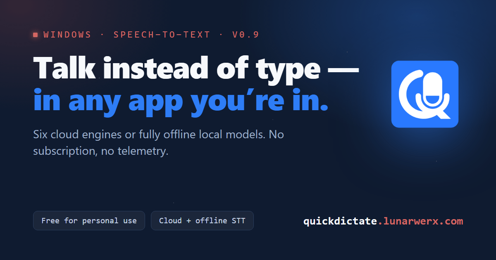
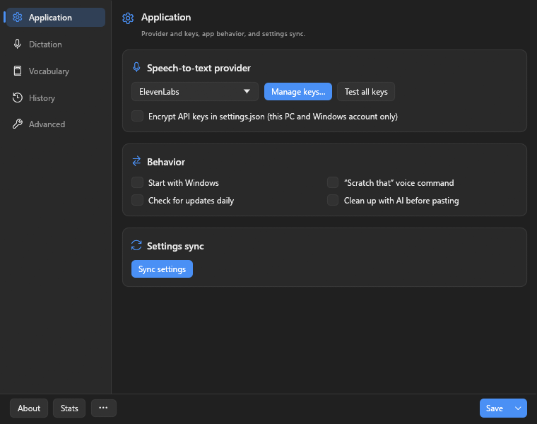

<div align="center">

<a href="https://quickdictate.github.io/">
  
</a>

<h1>QuickDictate</h1>

<p><b>Press a key, talk, and your words land wherever your cursor already is.</b></p>

<p>
Voice typing for Windows 10 and 11. Hold or tap a global hotkey, speak, and the transcript
types straight into whatever window has focus: your editor, a chat box, an email, a terminal,
any web text field. Use <i>your own</i> speech-to-text API key, or install an optional local
Whisper, Parakeet or Cohere model for fully offline dictation. <b>No QuickDictate subscription
or account.</b>
</p>

<p>
  <a href="https://github.com/LunarWerxs/QuickDictate/releases/latest/download/quickdictate.exe"><b>⬇️ Download for Windows</b></a>
  &nbsp;·&nbsp;
  <a href="https://quickdictate.github.io/"><b>🌐 Website</b></a>
  &nbsp;·&nbsp;
  <a href="docs/GUIDE.md">📖 Full guide</a>
  &nbsp;·&nbsp;
  <a href="CHANGELOG.md">📝 What's new</a>
</p>

<p>
  <a href="https://github.com/LunarWerxs/QuickDictate/releases/latest"></a>
  <a href="https://github.com/LunarWerxs/QuickDictate/releases/latest"></a>
  
  
  <a href="https://github.com/LunarWerxs/QuickDictate/stargazers"></a>
  <a href="https://discord.gg/PsWpeNUzhk"></a>
</p>

</div>

<br>

<div align="center">
  
  <br>
  <sub><i>Everything lives in one small settings window: providers, keys, hotkeys, and toggles.</i></sub>
</div>

QuickDictate is a Windows tray app for voice dictation and speech to text. It types your speech
directly into whatever window has focus, using your own API key from one of six cloud providers
(ElevenLabs, Deepgram, OpenAI, AssemblyAI, DashScope or Google) or an optional fully offline local
model, with no QuickDictate account, subscription, or dashboard involved. One small signed `.exe`,
no installer.

## 🔌 Fully offline dictation

Choose **Local (offline)** in Settings and QuickDictate transcribes without an API key or an internet
connection. Microphone audio stays on your PC.

| Model | Download | Best fit |
| :-- | --: | :-- |
| **Cohere Transcribe 03-2026 Q5_K_M** | 1.65 GiB | Accuracy-first default |
| **Whisper Large v3 Turbo Q5_K_M** | 591 MiB | Broadest language coverage |
| **Parakeet TDT 0.6B v3 Q5_K_M** | 524 MiB | Smallest and fastest, 25 European languages |

- **Manage everything in Settings:** install, select, cancel a download, or delete any model without
  hunting through folders.
- **Small app, on-demand models:** weights are not bundled in the executable. They download to
  `%LOCALAPPDATA%\QuickDictate\local-stt` and are size- and SHA-256-verified before use. The first
  install also adds a shared runtime of roughly 52 MiB.
- **Ready when you are:** the selected local model prewarms in the background and stays ready between
  dictations, and releases its RAM/VRAM when you return to a cloud provider.

## ✨ What you get

| | |
| :-- | :-- |
| 🔑 **Cloud or fully local** | Six bring-your-own-key services plus three optional offline models. Switch whenever you like. |
| ⌨️ **Types into any window** | Whatever has focus: your editor, a chat box, a terminal, or a web form. |
| ✋ **Hold or tap** | Push-to-talk, or tap to start and stop. Both are configurable, mouse buttons included. |
| 💬 **Clear live feedback** | Five cloud providers stream words as you talk; batch and Local modes show when the final result is processing. |
| 🪄 **Little touches that add up** | A custom vocabulary so your jargon is heard right the first time, a fix-list for words it mishears, per-app profiles, a searchable dictation history that survives restarts and updates, a *"scratch that"* voice command, and your music muted or turned down while you talk. |
| 🤖 **Works with AI tools** | Dictate prompts into Claude, ChatGPT, Cursor or any terminal, or run it as an MCP server so an AI app can transcribe audio files. |
| 🔒 **Your data stays yours** | Cloud audio goes only to the provider you pick; Local audio never leaves the PC. Optional settings sync is opt-in, and updates ask before installing. |

## 🚀 Quick start

1. **[Download `quickdictate.exe`](https://github.com/LunarWerxs/QuickDictate/releases/latest/download/quickdictate.exe)** from the latest release.
2. Run it. With no provider configured, Settings opens for you.
3. Pick how you want to transcribe:
   - **Cloud:** choose one of the six services and use **Manage keys…** to paste your API key.
   - **Offline:** choose **Local (offline)**, select Cohere, Whisper or Parakeet, and click **Install**.
4. Click **Save**, then press **F13** to hold or **F14** to toggle and start talking.

> [!TIP]
> Prefer files to forms? QuickDictate keeps one readable `settings.json` next to the executable.
> Start from [`settings.example.json`](settings.example.json) or edit the generated file.

> [!TIP]
> **Keeping the exe on your Desktop?** By default QuickDictate writes its `logs\` folder, usage
> stats, and update cache next to itself. **Settings ▸ Advanced ▸ Files** moves them: click
> **Use AppData** for `%LOCALAPPDATA%\QuickDictate`, or **Browse…** for anywhere you like.

## Use from AI tools (MCP)

QuickDictate can also serve as a transcription tool for AI apps. Run it with `--mcp` and it speaks the
Model Context Protocol over stdio, with no window, tray icon or hotkey:

```
quickdictate.exe --mcp
```

For Claude Code, register it once:

```
claude mcp add --scope user quickdictate -- "C:\path\to\quickdictate.exe" --mcp
```

Other MCP clients take the same command in their JSON config. Settings ▸ Advanced has both, ready to
copy, with the exe's real path.

- `list_engines` reports the installed local models and the cloud providers with a key, and which one
  `transcribe_file` uses by default.
- `transcribe_file` takes an absolute path to a wav, mp3, m4a/mp4, aac, flac or ogg file, with
  optional `engine` and `language`. It returns the text, the duration and the engine used.

## 📚 Learn more

Every setting, per-provider setup, and the privacy details live in the
**[complete guide](docs/GUIDE.md)**, with provider-specific notes in
**[docs/providers.md](docs/providers.md)**, including local model and storage details.

## ⚖️ How it compares

QuickDictate isn't the only hotkey dictation tool out there. Here's how it stacks up against a few
real alternatives, based on their own public sites as of 2026-08:

| | QuickDictate | Wispr Flow | Talon Voice | Windows Voice Access |
| :-- | :-- | :-- | :-- | :-- |
| **Speech engine** | Your pick of 6 cloud APIs (bring your own key) or 3 offline local models | Wispr's own cloud service | A scriptable voice-command engine; not general transcription by default | Built-in on-device Windows recognition |
| **Account/cost** | No QuickDictate account, you pay your chosen provider directly, or nothing with Local | Free tier capped at 2,000 words/week on desktop and 1,000 on iPhone, unlimited on Android; Flow Pro or team plans for unlimited use | Free, developer accepts optional Patreon support | Free, built into Windows 11 |
| **Works offline** | Yes, with the optional Local provider (Cohere, Whisper or Parakeet) | No, cloud only | Yes, its bundled Conformer engine runs on-device | Yes, after a one-time language-pack download |
| **Platforms** | Windows 10/11 | Windows, macOS, iPhone, Android | Windows, macOS, Linux | Windows 11 22H2+ |
| **Built for** | Speak, and it types into whatever's focused | Speak, and it types into whatever's focused | Hands-free computer control and voice coding, driven by user-written scripts | Accessibility-focused dictation and PC control |

The short version: QuickDictate's main difference from Wispr Flow is where your audio and money go:
to whichever provider you pick directly, or nowhere at all with Local, instead of through one bundled
cloud subscription. Talon Voice solves a different problem: it's a scriptable, hands-free control
system built around voice commands, not open-ended dictation. Windows Voice Access is free and
on-device, but it only offers Windows' own recognizer, with no choice of engine or provider.

## ❓ FAQ

**Is QuickDictate free?**
QuickDictate itself is free for personal and any other noncommercial use, with no subscription or
account. You bring your own API key for one of six cloud speech-to-text providers (ElevenLabs,
Deepgram, OpenAI, AssemblyAI, DashScope, or Google), which bill you directly per their own pricing, or
you skip the cloud entirely and use the free offline Local provider. Business use needs a license
(see below).

**Is there a Wispr Flow or SuperWhisper alternative for Windows?**
That's what QuickDictate is: hold a key, talk, and the text types into the focused app, on Windows
10 and 11, with your own cloud key or a local Whisper, Parakeet or Cohere model. There is no word cap
and no subscription.

**Can I use OpenAI Whisper for dictation on Windows?**
Yes, two ways: pick **OpenAI** as the cloud provider with your own key, or install **Whisper Large v3
Turbo** under Local and dictate offline with no key at all.

**How is it different from Windows voice typing (Win+H)?**
Windows voice typing uses Microsoft's recognizer only. QuickDictate lets you pick the engine
(Deepgram, ElevenLabs Scribe, OpenAI, AssemblyAI, Google, or a local model), adds push-to-talk
hotkeys, a custom vocabulary, per-app profiles and a dictation history.

**Does it work offline?**
Yes. Choose Local in Settings and install the Cohere Transcribe, Whisper Large v3 Turbo or Parakeet TDT
v3 model (1.65 GiB, 591 MiB and 524 MiB respectively); once installed, microphone audio never leaves
your PC and no internet connection or API key is needed.

**What are the system requirements?**
Windows 10/11 x64 only; there's no Mac or Linux build. The app itself is small; the optional offline
models need extra disk space and enough RAM/VRAM to keep the selected model resident while Local is
active.

**Is my data sent anywhere?**
Your microphone audio goes only to the one cloud provider you select (or nowhere, with the Local
option), never to the QuickDictate maintainer. QuickDictate itself reports only two things: the update
check, at most once a day while *Check for updates daily* is on, and, only if you opt in, a
pseudonymous daily usage rollup (numbers only, never your words). An opt-in settings sync can also
sync preferences like hotkeys and language, but never your API keys, audio, or transcripts.

**Do I need an account to use QuickDictate?**
No. There's no QuickDictate account, login, or dashboard; the entire app is one local Settings
window. You'll need an account with whichever cloud provider you choose (to get an API key), unless
you pick the Local offline provider.

**Which speech-to-text providers does QuickDictate support?**
Six bring-your-own-key cloud providers (ElevenLabs, Deepgram, OpenAI, AssemblyAI, DashScope, and
Google Cloud Speech-to-Text), plus Connections Dictation (live, using your Connections minutes, no
key), and an offline Local option with a choice of three models (Cohere Transcribe, Whisper Large v3
Turbo or Parakeet TDT v3). Five of the six cloud providers stream words live as you talk.

**Can I use QuickDictate in any application?**
Yes. It types into whatever window has focus: code editors, browsers, chat apps, terminals, or any
text field. Per-app profiles can change punctuation, spacing, or even which provider is used based on
the focused application.

**Windows SmartScreen or my antivirus warned me. Is it safe?**
Releases from v1.4.0 on are code-signed by LUNARWERX LLC, and every release publishes a
`SHA256SUMS.txt`. QuickDictate uses a global hotkey and types by simulating keystrokes, which some
antivirus tools flag as a false positive. A new signature also takes a while to build SmartScreen
reputation: click **More info** → **Run anyway**.

## 🐛 Feedback

Bug reports and ideas are welcome: [open an issue](https://github.com/LunarWerxs/QuickDictate/issues/new/choose)
or ask on [Discord](https://discord.gg/PsWpeNUzhk).

## 📄 License

Free for personal use, and for nonprofit organisations and government bodies; a business may try it
free for up to 10 days on each installation (see the additional permissions in [LICENSE](LICENSE)).
Commercial use needs a license from LunarWerx Studios, one per installation:
[US$19.99 once](https://checkout.connections.icu/licence/bf8dca80-4036-48ad-91f4-80baa1dbb9e3)
(perpetual) or [US$1.99 a month](https://checkout.connections.icu/licence/955db7f6-6561-4a30-85d7-569ea3b3ff20)
(cancel any time at [checkout.connections.icu/manage](https://checkout.connections.icu/manage)). To
move a license to another PC or ask for a refund, email [lunawerx@gmail.com](mailto:lunawerx@gmail.com).
Redeem the key from your purchase email in **Settings › Licence**.

The source code is private, © LunarWerx Studios. Copies of the code published here earlier keep the
license they came with: MIT through v0.8.0, then [PolyForm Noncommercial 1.0.0](LICENSE).

Made with care by **[LunarWerx Studios](https://lunarwerx.com)**. Also from LunarWerx Studios:
[RepoYeti](https://repoyeti.com), [SageThumbs](https://sagethumbs.lunarwerx.com), and
[DevWebUI](https://devwebui.lunarwerx.com).
